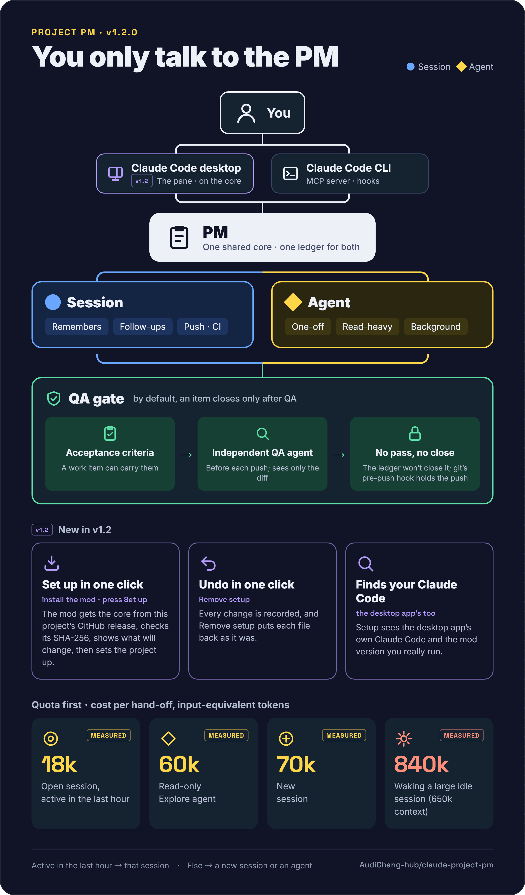
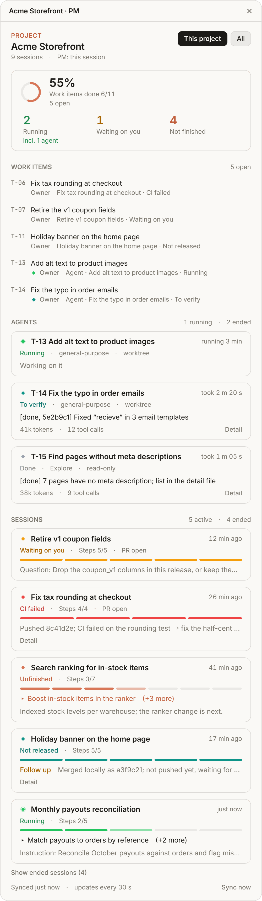
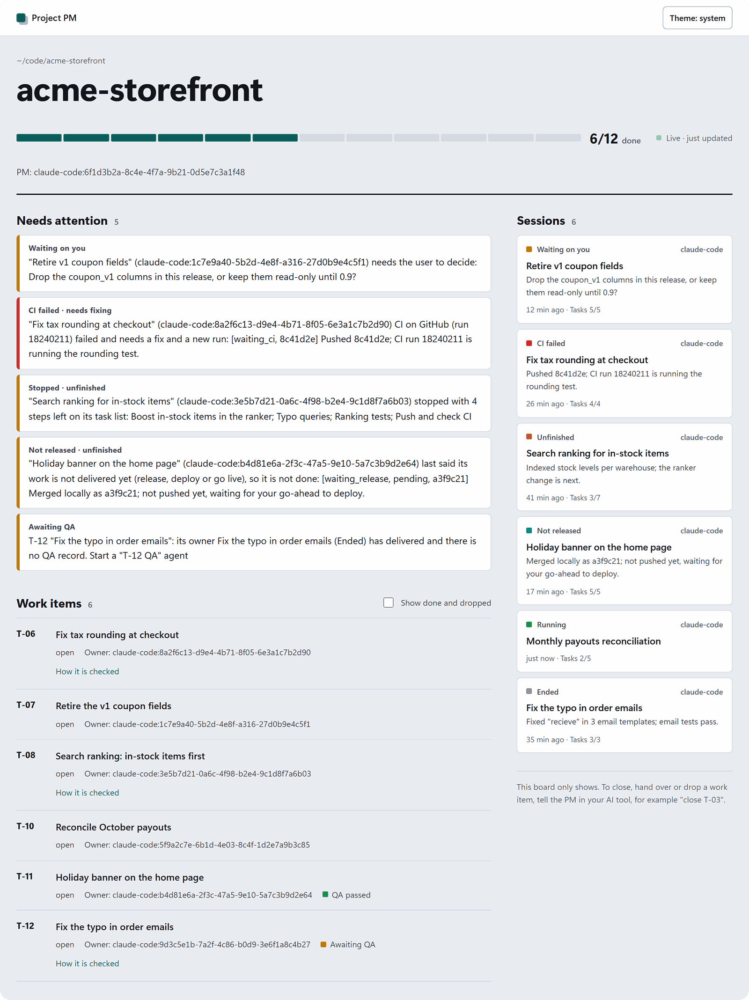
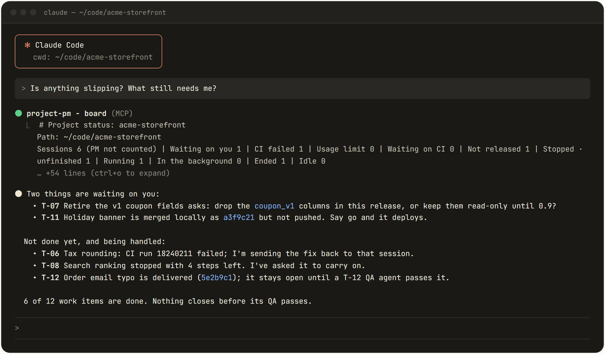
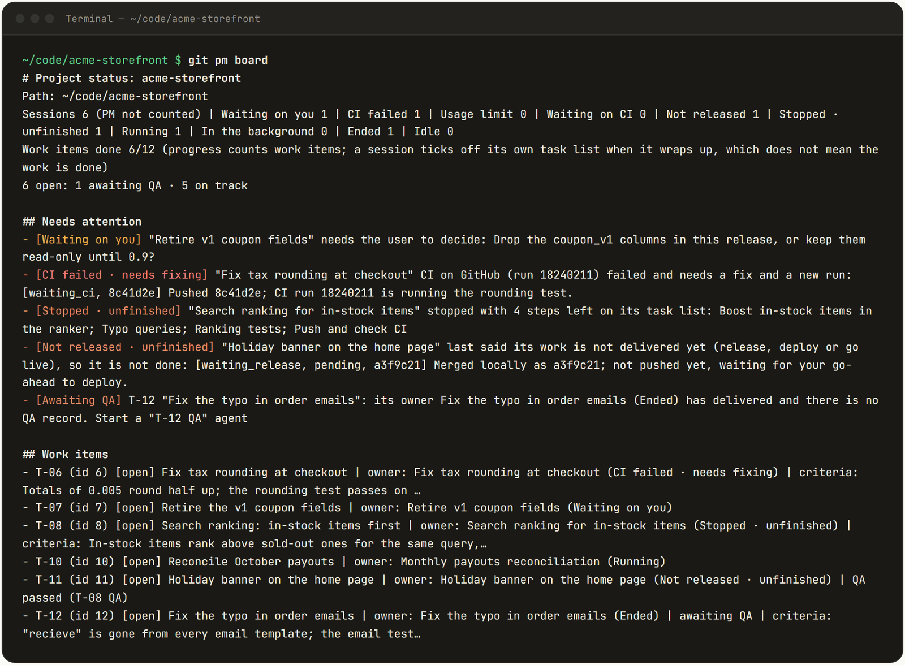

# Project PM for Claude Code

**English** | [繁體中文](README.zh-TW.md)

[](https://github.com/AudiChang-hub/claude-project-pm/actions/workflows/ci.yml)
[](LICENSE)

**Run many Claude Code sessions and agents at once. You talk to one PM, and nothing slips.**

<picture>
  <source media="(prefers-color-scheme: dark)" srcset="docs/images/hero-dark.png">
  
</picture>

<p align="center">
  
</p>

## Why

With several sessions open on one project, work slips: a question waits an hour for you, a session stops with steps left, "CI is running, I'll deploy after" never gets checked, and every session ticks its own checklist done whether the work is or not.

Project PM makes one session the project's PM. It keeps a live board of every session and agent and a ledger of everything you asked for, and it won't call work done while anything is waiting on you, unfinished, waiting on CI, or not yet pushed or released.

## New in v1.2

- **Set up in one click.** Install the mod, then press **Set up** (設定) on the board. Nothing to download or type: the mod gets the core from this project's GitHub release, checks it against the release's SHA-256 list, and shows what will change before it changes anything.
- **Remove it in one click.** **Remove setup** (移除設定) puts every file back as it was.
- **Setup finds your Claude Code.** It now sees the Claude Code the desktop app ships with, and the version of the mod you really run.

v1.1 (one ledger for both apps, a clearer board, the web board from the pane) and earlier: [CHANGELOG](CHANGELOG.md)

## Install

**Claude Code desktop app** (Code tab):

```
/plugin install project-pm --marketplace AudiChang-hub/claude-project-pm
```

Or **+** next to the prompt box → **Plugins** → **Add marketplace** → `AudiChang-hub/claude-project-pm` → **Add plugin**.

Then open a new session in your project and make it the PM (the button above the prompt box, or `/pm`). At the top of the board, press **Set up** (設定). That's all: the board lists what will change first, and **Remove setup** (移除設定) undoes it. If you're offline, or the download fails, the board says so and offers **Try again**.

To keep it updated: `claude` → `/plugin` → **Marketplaces** → `claude-project-pm` → **Enable auto-update**.

**Claude Code CLI** (no desktop app): download the file for your computer from [Releases](https://github.com/AudiChang-hub/claude-project-pm/releases) and run it with `init` in your project's folder. It changes nothing until you add `--yes`. Or put the file in your project's folder and double-click it: it lists what will change, sets up when you press Enter, and opens the board once set up. An npm version (`npx`) comes in a later release.

Step by step, and what to do when Windows or macOS warns you (those steps are not yet checked on a real download): [core/README.md](core/README.md).

## Platform support

✅ available · ◐ partial · — not offered

| Feature | Claude Code desktop | Claude Code CLI¹ |
| --- | :-: | :-: |
| One-click setup | ✅ | — |
| Board | ✅ | ✅ |
| Web board² | ✅ | ✅ |
| Ledger, shared by both³ | ✅ | ✅ |
| QA gate, shared by both³ | ✅ | ✅ |
| Delivery check (git, CI) | ✅ | ◐ |
| Live session tracking | ✅ | ◐ |
| Agent hand-off | ✅ | ◐ |
| Development guidelines | ✅ | ✅ |
| CI template⁴ | ✅ | ✅ |

¹ Tested with Claude Code 2.1.326. The board is the web board and `git pm board`. Partial: CI status (git is checked), sessions seen only through hooks, and no automatic agent set-up.
² Needs the core: **Set up** on the desktop board, or the CLI step above. In the desktop app: **Open in browser** on the pane.
³ Once set up; before that, the desktop app keeps its own.
⁴ GitHub Actions, run in your repository on every push and pull request.

As of v1.2. Updated with every release.

## What the PM guards

- **Waiting on you comes first**, with the question quoted.
- **CI isn't done until GitHub says so**: the PM checks the run with `gh`.
- **Not shipped isn't done**: git decides what is committed and pushed, and a session's report says what is released.
- **The ledger won't close unfinished or unchecked work** unless you say so.

<details>
<summary><b>See the board</b> (demo data)</summary>
<br>
<p align="center">
  <picture>
    <source media="(prefers-color-scheme: dark)" srcset="docs/images/board-dark.png">
    
  </picture>
</p>
</details>

Every status, how delivery is judged, development guidelines and what the mod keeps on disk: [How it works](docs/how-it-works.md).

## Commands (desktop app)

| Command | What it does |
| --- | --- |
| `/pm` | Makes this session the project's PM and opens the board. |
| `/pm off` | Steps down. The ledger stays for the next PM. |
| `/board` | Opens or closes the board in any session. |
| `/pm lang en` · `zh-TW` · `auto` | Board and PM language; `auto` follows your system. |
| `/pm guidelines <file>` · `off` | Gives the PM and its sessions your development rules. |

**Two boards.** Claude Code desktop: the board is the pane on the right (the image at the top). The web board shows the same work in your browser, for the CLI or a second screen:

- **Set up first:** press **Set up** at the top of the desktop board (or, without the desktop app, the CLI step above).
- **Open it:** in the desktop app, press **Open in browser** at the bottom of the pane. In a terminal, run `git pm open` in your project's folder. Or ask the PM for "the board link".
- **Typing `127.0.0.1:47130` alone shows an error page.** The board opens only from the link Project PM gives you, which carries a private key, so other programs on your computer cannot read it.

<picture>
  <source media="(prefers-color-scheme: dark)" srcset="docs/images/web-board-dark.png">
  
</picture>

<details>
<summary><b>See it in the CLI</b> (demo data)</summary>
<br>
In a terminal, the PM reads the board and tells you what needs you:

<code>git pm board</code> prints the same board, sessions by name:

</details>

## Requirements

- The Claude Code desktop app (mod, tested with 2.1.317), or Claude Code's CLI (core, tested with 2.1.326).
- One-click setup downloads with your system's own `curl` (in Windows 10 and 11, macOS and most Linux).
- It uses the OS `curl` because a mod's API can't write binary files. It asks GitHub for `SHA256SUMS` through Claude Code first, so your organization's network rules still apply, and it runs the program only after its SHA256 matches.
- Optional: the [GitHub CLI](https://cli.github.com/), signed in, so the PM can check CI.
- Agents that change files need a git repository. In the desktop app they run inside the PM's process, so restarting Claude Code interrupts them; the board marks them *interrupted*.

## License

[MIT](LICENSE). Tests: `claude plugin test .` and, in `core/`, `npm test`.
