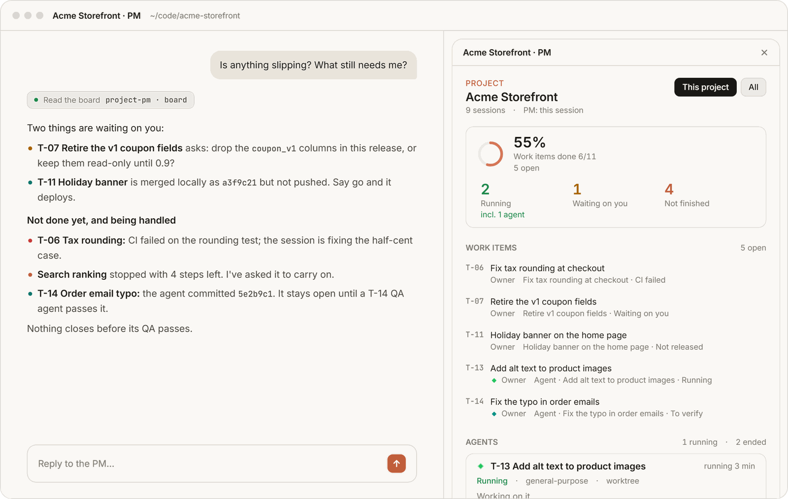

# Project PM for Claude Code

**English** | [繁體中文](README.zh-TW.md)

[](https://github.com/AudiChang-hub/claude-project-pm/actions/workflows/ci.yml)
[](LICENSE)

**Run many Claude Code sessions and agents at once. You talk to one PM, and nothing slips.**

<picture>
  <source media="(prefers-color-scheme: dark)" srcset="docs/images/hero-dark.png">
  
</picture>

<p align="center">
  
</p>

## Why

With several sessions open on one project, work slips: a question waits an hour for you, a session stops with steps left, "CI is running, I'll deploy after" never gets checked, and every session ticks its own checklist done whether the work is or not.

Project PM makes one session the project's PM. It keeps a live board of every session and agent and a ledger of everything you asked for, and it won't call work done while anything is waiting on you, unfinished, waiting on CI, or not yet pushed or released.

## New in v1.0

- **The CLI works too.** One shared core serves the PM's tools over MCP, so Claude Code's command line gets the board, the ledger and the QA gate. It shares one ledger with the desktop app.
- **QA before the push.** A git pre-push hook holds commits no QA passed; `git pm skip "<reason>"` lets one through on the record.
- **A CI template for your projects.** `init --ci` adds GitHub Actions: your tests, leaked keys, risky packages and words you keep private.
- **One program, no Node.js.** A single executable for Windows, macOS and Linux (an npm version comes later). `init` lists every change before making it; `uninstall` puts every file back.
- **A web board** in your browser, read only and on your own computer.

v0.9.x (QA gate, quota-first hand-offs): [CHANGELOG](CHANGELOG.md)

## Install

**Claude Code desktop app** (Code tab):

```
/plugin install project-pm --marketplace AudiChang-hub/claude-project-pm
```

Or **+** next to the prompt box → **Plugins** → **Add marketplace** → `AudiChang-hub/claude-project-pm` → **Add plugin**. Then open a new session in your project and type `/pm`. To keep it updated: `claude` → `/plugin` → **Marketplaces** → `claude-project-pm` → **Enable auto-update**.

**Claude Code CLI:** download the file for your computer from [Releases](https://github.com/AudiChang-hub/claude-project-pm/releases) and run it with `init` in your project's folder. It changes nothing until you add `--yes`. An npm version (`npx`) comes in a later release.

Step by step, and what to do when Windows or macOS warns you (those steps are not yet checked on a real download): [core/README.md](core/README.md).

## Platform support

✅ available · ◐ partial

| Feature | Claude Code desktop | Claude Code CLI¹ |
| --- | :-: | :-: |
| Board | ✅ | ✅ |
| Ledger | ✅ | ✅ |
| QA gate | ✅ | ✅ |
| Delivery check (git, CI) | ✅ | ◐ |
| Live session tracking | ✅ | ◐ |
| Agent hand-off | ✅ | ◐ |
| Development guidelines | ✅ | ✅ |
| CI template² | ✅ | ✅ |

¹ Tested with Claude Code 2.1.326. The board is the web board and `project-pm board`. Partial: CI status (git is checked), sessions seen only through hooks, and no automatic agent set-up.
² GitHub Actions, run in your repository on every push and pull request.

Updated with every release.

## What the PM guards

- **Waiting on you comes first**, with the question quoted.
- **CI isn't done until GitHub says so**: the PM checks the run with `gh`.
- **Not shipped isn't done**: git decides what is committed and pushed, and a session's report says what is released.
- **The ledger won't close unfinished or unchecked work** unless you say so.

<details>
<summary><b>See the board</b> (demo data)</summary>
<br>
<p align="center">
  <picture>
    <source media="(prefers-color-scheme: dark)" srcset="docs/images/board-dark.png">
    
  </picture>
</p>
</details>

Every status, how delivery is judged, development guidelines and what the mod keeps on disk: [How it works](docs/how-it-works.md).

## Commands (desktop app)

| Command | What it does |
| --- | --- |
| `/pm` | Makes this session the project's PM and opens the board. |
| `/pm off` | Steps down. The ledger stays for the next PM. |
| `/board` | Opens or closes the board in any session. |
| `/pm lang en` · `zh-TW` · `auto` | Board and PM language; `auto` follows your system. |
| `/pm guidelines <file>` · `off` | Gives the PM and its sessions your development rules. |

**Two boards.** Claude Code desktop: the board is the pane on the right (the image at the top). Claude Code CLI: ask Claude to be the PM, then `project-pm open` opens this web board in your browser:

<picture>
  <source media="(prefers-color-scheme: dark)" srcset="docs/images/web-board-dark.png">
  
</picture>

## Requirements

- The Claude Code desktop app (mod, tested with 2.1.317), or Claude Code's CLI (core, tested with 2.1.326).
- Optional: the [GitHub CLI](https://cli.github.com/), signed in, so the PM can check CI.
- Agents that change files need a git repository. In the desktop app they run inside the PM's process, so restarting Claude Code interrupts them; the board marks them *interrupted*.

## License

[MIT](LICENSE). Tests: `claude plugin test .` and, in `core/`, `npm test`.
