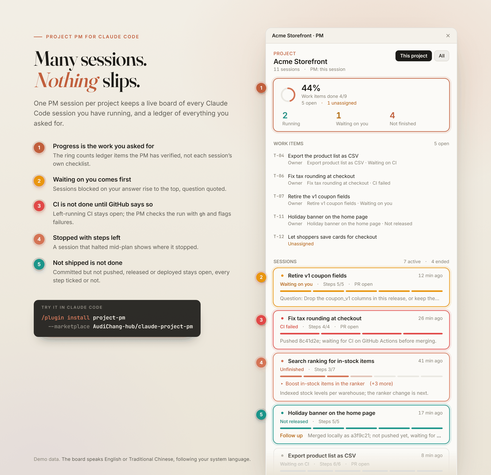
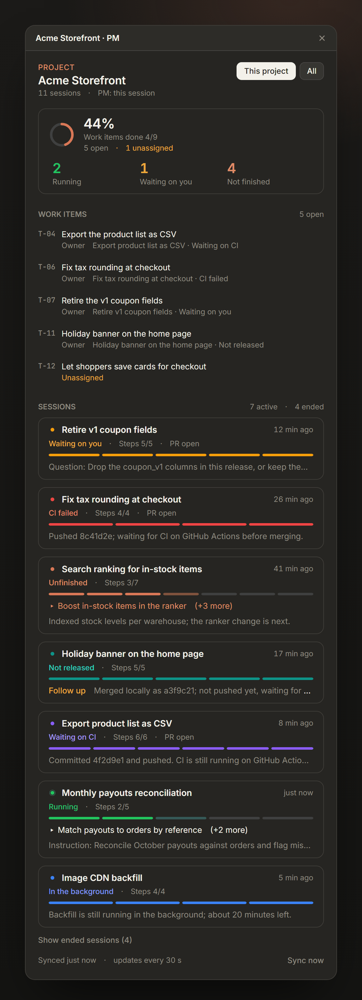

# Project PM for Claude Code

**English** | [繁體中文](README.zh-TW.md)

**Run many Claude Code sessions in parallel without losing track of any work.**

[](https://github.com/AudiChang-hub/claude-project-pm/actions/workflows/ci.yml)
[](LICENSE)

Project PM gives each project one PM session. You talk to the PM; the PM keeps a live board of every other session in that project and a ledger of everything you asked for, and it will not call the work done while a session is waiting on you, stopped halfway, or still waiting on CI.

<p align="center">
  
</p>

<sub>Demo data. The board speaks English or Traditional Chinese, following your system language (see [Language](#language)).</sub>

## Why

With five or ten sessions open on one project, things slip:

- A session asked you a question an hour ago and has been sitting there since.
- A session stopped with three steps of its plan left, and nothing tells you.
- A session said "CI is running, I'll deploy once it passes", and then nobody came back to check.
- Every session ticks its own checklist off when its turn ends, so "all green" in the sidebar does not mean the thing you asked for is done.

Project PM reads every session's task list, final recap and open question, checks CI on GitHub, and puts what needs you at the top of one board.

## Quick start

Requires the **Claude Code desktop app (Code tab)**; see [Requirements](#requirements).

1. Install the plugin. In a Claude Code prompt:

   ```
   /plugin install project-pm --marketplace AudiChang-hub/claude-project-pm
   ```

   In the desktop app, where `/plugin` is not available: click **+** next to the prompt box → **Plugins** → **Add marketplace**, enter `AudiChang-hub/claude-project-pm`, then **Add plugin**.

   Or from a shell:

   ```bash
   claude plugin install project-pm --marketplace AudiChang-hub/claude-project-pm
   ```

2. Open a new session in your project (sessions opened before the install do not load it) and type:

   ```
   /pm
   ```

   That session becomes the project's PM, opens the board, and reports what is waiting on you.

3. From then on, talk to the PM: *"Is anything slipping?"*, *"Hand the CSV export to the product-list session."*, *"Which sessions are waiting on me?"*

## Features

**One board per project.** A pane that lists the project's sessions, most urgent first, each with a status mark, a step-by-step progress bar, the step it is on, and its latest recap or question.

| Status | Shown when |
| --- | --- |
| Waiting on you (待回覆) | The session ended its turn with a question for you. |
| CI failed (CI 失敗) | Its last words left CI running, and GitHub reports that run failed. |
| Unfinished (未完成) | It stopped with steps of its task list still open, and nothing it waits on is still running. |
| Not released (待發布) | Its latest recap or answer says its work is not delivered yet: not committed, not pushed, not released, deployed or live, or waiting on a go-ahead (等 PM 放行). A fully ticked task list does not override it (`wrap_up` ticks every step). Sentences about a rule or an example, quoted words, someone else's work and double negatives (沒有任何未提交的修改) do not count. When only a push is left and the words name the commit, it clears once that commit, or its content (rebased or squashed with others), is on a remote branch, as when the PM pushes it from this machine. |
| Waiting on CI (等待 CI) | Its last words say CI has not finished, and GitHub has not said it passed. |
| Running (執行中) | The session is working right now. |
| In the background (背景執行) | A command it started in the background (`run_in_background`, or moved there) has not reported back yet, for up to 6 hours; or, for a session without that record, it said work goes on in the background (for up to 45 minutes). Open steps on its task list do not make it *Unfinished* meanwhile. |
| Ended (已結束) / Idle (長期閒置) | Nothing left; idle for more than 3 days. Hidden behind a toggle. |

At the top: a completion ring and three counters (running, waiting on you, not finished: unfinished, waiting on CI, CI failed or not released). Switch between **this project** and **all projects**.

**A ledger of what you asked for.** Every request you give the PM is recorded as T-01, T-02, … with the session that owns it. Project progress is counted from the ledger, not from the sessions' own checklists. An owner working from another project's folder (a session fixing a shared library, say) is still shown with its title and status; the item is flagged only when its owner is archived or gone.

**CI is not done until GitHub says so.** When a session's latest words say CI is still running, or that it will deploy once checks pass, the session is held at *Waiting on CI*, however long ago it stopped. Quoted words (a status named 「等待 CI」) and sentences about a rule or an example do not count. The PM then runs `gh` in that session's folder: the runs and commits the words name, nearest their own CI words first, a commit only when it is in that repository (a hash quoted from another project or an example is skipped), and when none of them answers, the folder's `HEAD` (only if it was committed before the words). A pass clears the status, a failure turns it into *CI failed*. Answers are cached: a pass for good, a failure for 5 minutes, a running or unknown result for 1 minute. Without `gh`, or outside GitHub, the words decide.

**The ledger will not close unfinished work.** Marking an item done is refused while its owner is running, waiting on you, unfinished, waiting on CI, failed CI, not released or still working in the background, unless you confirm it explicitly and the PM records why in a note.

**Recaps that admit work is left.** A recap that says something is "not yet deployed", "not committed", "still needs…" (in English or Chinese) is flagged for follow-up. A Chinese double negative such as 沒有任何未提交的修改 ("there are no uncommitted changes") is not.

**Only the latest turn counts.** A recap belongs to the turn that wrote it; a later turn that ends without its own recap clears it. If a session's record has missed later turns, its transcript's last message is used instead.

**A PM that behaves like one.** The PM reads the board before every report, hands implementation to other sessions instead of editing code itself, relays sub-sessions' questions to you word for word, asks before archiving anything, and will not say "all done" while anything needs attention. It gets a notification when a session starts waiting on you, fails CI, or stops with steps left.

**Housekeeping.** Archive a finished session from its card (hover to reveal, then confirm; the confirm warns about open steps, an open PR or a pin). In a project with no PM yet, a band above the prompt offers to start a PM session or make the current one the PM.

<p align="center">
  
</p>

## Usage

| Command | What it does |
| --- | --- |
| `/pm` | Makes this session the project's PM and opens the board. |
| `/pm off` | Steps down as PM. The ledger stays with the project for the next PM. |
| `/board` | Opens or closes the board in any session. |
| `/pm lang en` · `/pm lang zh-TW` · `/pm lang auto` | Switches the language of the board, the PM and its tools at once, and saves it as the `language` option. `auto` follows the system. |

The PM has two tools of its own, which you do not call directly:

- `mcp__project-pm__board`: the project status report (what needs attention, the ledger, every session). Pass `scope: "all"` for every project, `include_done: true` to list finished sessions and items too.
- `mcp__project-pm__ledger`: `add`, `update` (owner, status `open` / `done` / `dropped`, note) and `list` the work items.

A project is the folder a session works in; a git worktree under `.claude/worktrees/` or `.worktrees/` counts as its repository.

## Requirements

- **Claude Code desktop app, Code tab.** The PM uses the app's built-in session tools (`ccd_session_mgmt` to list, read and archive sessions; `ccd_session` to start the PM session), and sessions report their task lists through the app's `update_plan` and `wrap_up`. Sessions that keep their tasks with `TodoWrite` instead are tracked as well.
- **A Claude Code version that supports function-hook mods.** Tested with 2.1.299.
- **Optional: the [GitHub CLI](https://cli.github.com/) (`gh`), signed in,** to check CI on GitHub. Without it, CI status is judged from what the sessions said.
- In an organization that manages Claude Code, the PM's role instructions (a `prompt.compose` hook) only apply when the organization lists this plugin in its managed settings. The board and the ledger work either way.

## Language

The board, the band above the prompt, the commands' replies, the notifications, the PM's instructions and its tools speak **English** or **Traditional Chinese**.

- **By default it follows the system language** (on Windows, the display language): any Chinese locale shows Traditional Chinese, everything else English. Simplified Chinese locales show Traditional Chinese too; run `/pm lang en` if you would rather read English.
- **To choose one**, set the plugin's `language` option to `auto`, `en` or `zh-TW` (the `project-pm.language` row in `/config`, stored under `pluginConfigs` in `settings.json`), or type `/pm lang en`, `/pm lang zh-TW` or `/pm lang auto` in any session. The command takes effect at once and saves the option.
- Reading what sessions report works in both languages whichever one the board speaks, so sessions can work in English or Chinese.

Every string lives in [`hooks/messages.ts`](hooks/messages.ts), one table per language.

## Data and privacy

- Each session writes only its own record: `~/.claude/project-pm/sessions/<session id>.json` (its task list, last recap, open question, latest prompt and last answer, clipped).
- Each project has one file for its PM and ledger: `~/.claude/project-pm/projects/<project>-<hash>.json`.
- The mod itself sends nothing anywhere. Listing, reading and archiving sessions go through the desktop app's built-in tools. To check CI it runs `git` and `gh` in the session's folder, so `gh` contacts GitHub with your own login, as it would if you ran it yourself.
- Sessions opened before the install keep no record; the board shows their last message, read from the transcript.
- When the engine drops the PM's `board` and `ledger` tools (after `/reload-plugins`, or when the mod's folder changed and a command of it such as `/board` reloads it), they come back on the PM's next turn (your next message or a notification) or within 30 seconds while the PM is idle; no need to restart the session.

## Development

```bash
claude plugin validate .
claude plugin test .
```

The tests (`tests/pm.test.ts`) run against Claude Code's plugin test host with an in-memory desktop app, disk and `gh`; they need no login or API key. CI runs the same two commands on every push and pull request.

`docs/demo/board.html` draws the README images from made-up data; see [docs/demo/README.md](docs/demo/README.md).

Changes are listed in [CHANGELOG.md](CHANGELOG.md).

## License

[MIT](LICENSE)
