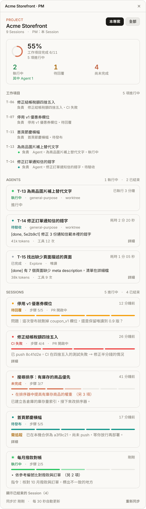

# Project PM：Claude Code 的專案 PM

[English](README.md) | **繁體中文**

[](https://github.com/AudiChang-hub/claude-project-pm/actions/workflows/ci.yml)
[](LICENSE)

**同時開很多個 Claude Code Session 和 Agent，你只跟一個 PM 說話，一件工作也不漏。**

<p align="center">
  
</p>

## 解決什麼問題

同一個專案開了好幾個 Session，工作就會漏掉：問題等你等了一小時、Session 還剩幾步就停了、說好「CI 跑完再部署」卻沒人回頭確認，而且每個 Session 收尾時都會把自己的清單全勾掉，不管事情做完了沒。

Project PM 讓專案裡的一個 Session 擔任 PM。它即時掌握每個 Session 和 Agent 的狀態，記下你交辦的每件事；只要還有事在等你、沒做完、等 CI，或還沒 push、還沒發布，它就不會說「都完成了」。

## 快速上手

需要 Claude Code 桌面版（Code 分頁）。

1. 安裝：

   ```
   /plugin install project-pm --marketplace AudiChang-hub/claude-project-pm
   ```

   桌面版：點提示框旁的 **+** → **Plugins** → **Add marketplace** → 輸入 `AudiChang-hub/claude-project-pm` → **Add plugin**。

2. 在專案裡新開一個 Session，輸入 `/pm`。它會成為 PM、打開看板，並告訴你有哪些事在等你。
3. 直接跟 PM 說話：「有沒有漏掉的工作？」「找出沒有頁面描述的頁面。」「哪些 Session 在等我回覆？」
4. 保持更新。第三方 Plugin，Claude Code 不會自己更新：在終端機執行 `claude` → `/plugin` → **Marketplaces** → `claude-project-pm` → **Enable auto-update**，或手動執行 `claude plugin update project-pm@claude-project-pm`。

## v0.8.0 亮點

- **PM 可以派工給 Agent。** 做完就結束的小事，交給背景 Agent，你照樣跟 PM 說話。之後還會追問、要 push、等 CI 或發布的工作，仍然交給 Session。看板上 Agent 和 Session 並列（Session 是 ●，Agent 是 ◆），看得到狀態、耗時和 token 用量。
- **大幅省 token。** 交辦清單每次更新只回傳改到的那一項（實際清單從 10,354 字降到 278 字），看板縮短 37–49%，完整說明寫進詳細檔，在卡片上按「詳細」就能打開。
- **預設就安全。**
  - 會改檔案的 Agent 在自己的 git worktree 工作，不會動到你的工作目錄；不是 git repo 的專案，PM 不能開這種 Agent。
  - 它的 commit 要等 PM 合併進你的分支才算完成。
  - Agent 只能讀交辦清單、不能修改，也不會 push 或發布。

[發布說明](https://github.com/AudiChang-hub/claude-project-pm/releases/tag/v0.8.0) · [CHANGELOG](CHANGELOG.md) · [Agent 怎麼運作](docs/design/agents.md)

## PM 幫你守住什麼

- **等你回覆的排最前面**，附上原本的問題。
- **CI 要 GitHub 說通過才算**：PM 用 `gh` 查實際結果。
- **沒上線就不算完成**：有沒有 commit、push 由 git 判斷，有沒有發布看 Session 的回報。
- **沒做完的工作不能結案**，除非你明確同意。

<details>
<summary><b>看看板長什麼樣</b>（示範資料）</summary>
<br>
<p align="center">
  <picture>
    <source media="(prefers-color-scheme: dark)" srcset="docs/images/board-dark-zh-TW.png">
    
  </picture>
</p>
</details>

每個狀態的意思、交付怎麼判斷、開發準則，以及 Mod 在你電腦上留下哪些資料：[運作方式](docs/how-it-works.zh-TW.md)。

## 指令

| 指令 | 作用 |
| --- | --- |
| `/pm` | 讓目前的 Session 擔任 PM，並打開看板 |
| `/pm off` | 卸任 PM；交辦清單留給下一任 |
| `/board` | 在任何 Session 打開或收合看板 |
| `/pm lang en`・`zh-TW`・`auto` | 看板和 PM 的語言；`auto` 跟隨系統 |
| `/pm guidelines <檔案>`・`off` | 讓 PM 和各 Session 遵守你的開發準則 |

## 需求

- **Claude Code 桌面版**（Code 分頁）：PM 會用到它內建的 Session 工具。
- 支援 function hooks Mod 的 Claude Code，已在 2.1.317 測試。
- 選用：已登入的 [GitHub CLI](https://cli.github.com/)，讓 PM 能查 CI。
- 會改檔案的 Agent 需要 git repo。Agent 跑在 PM 的程序裡，重開 Claude Code 會中斷它們，看板會標成「已中斷」。

## 授權

[MIT](LICENSE)。測試：`claude plugin validate .` 與 `claude plugin test .`，不需要登入。
