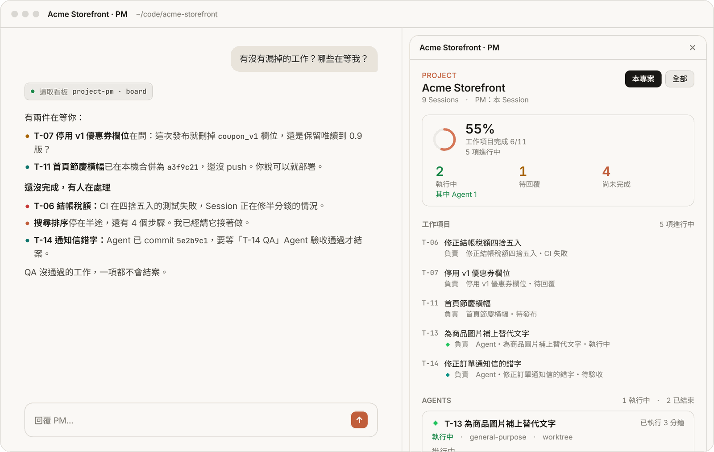
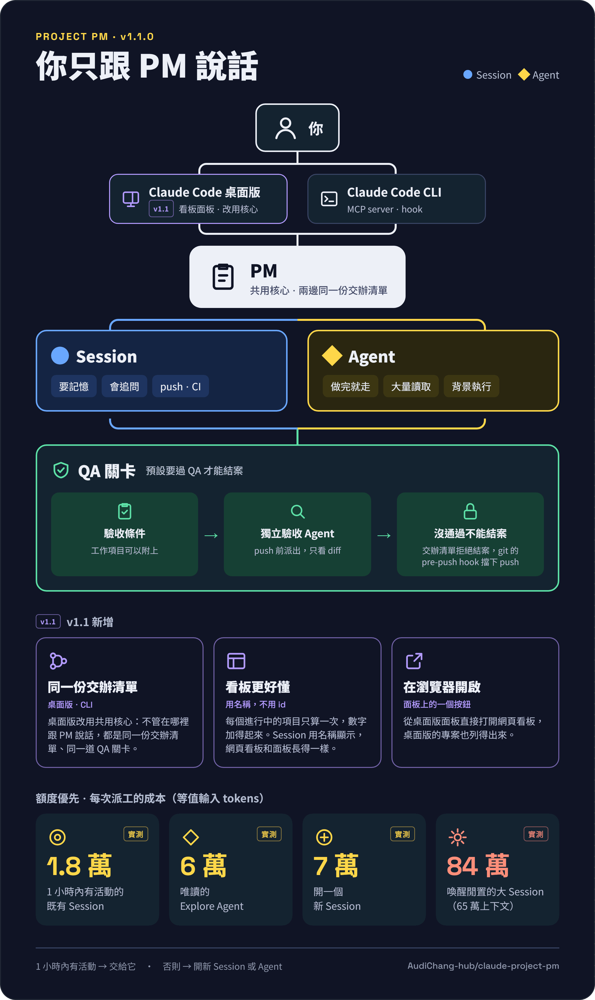
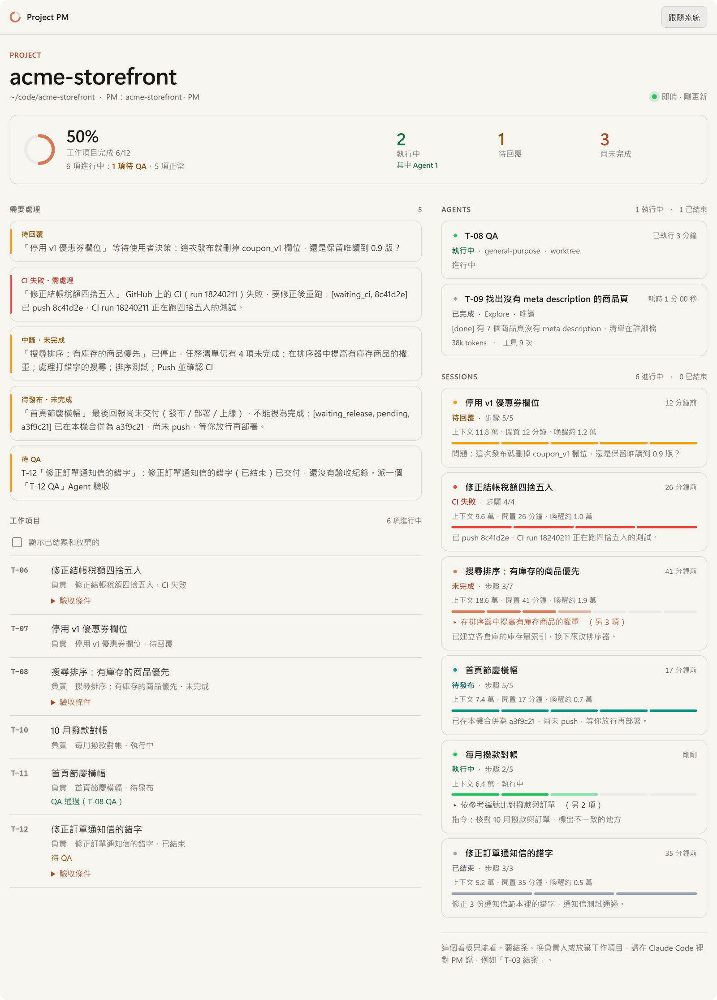
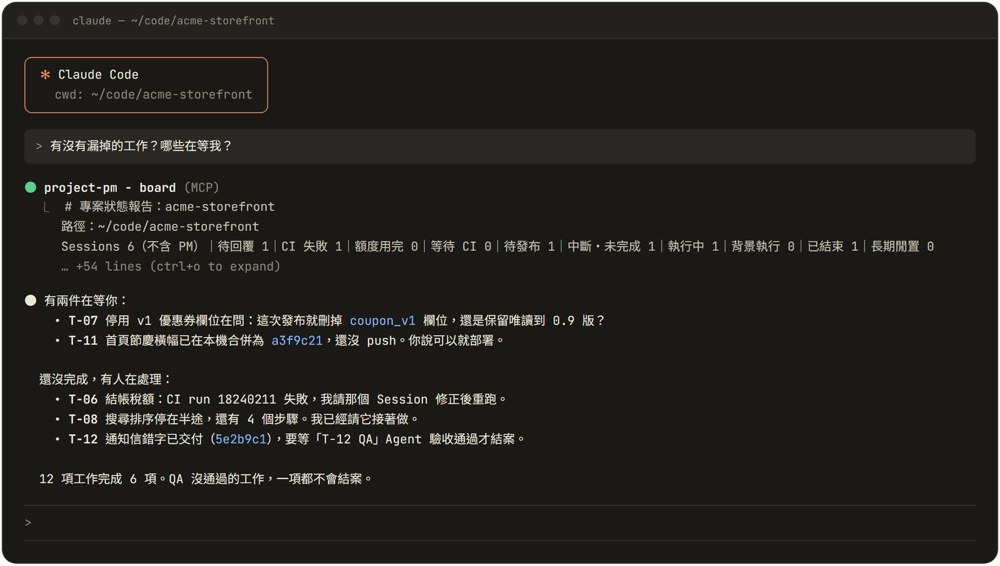
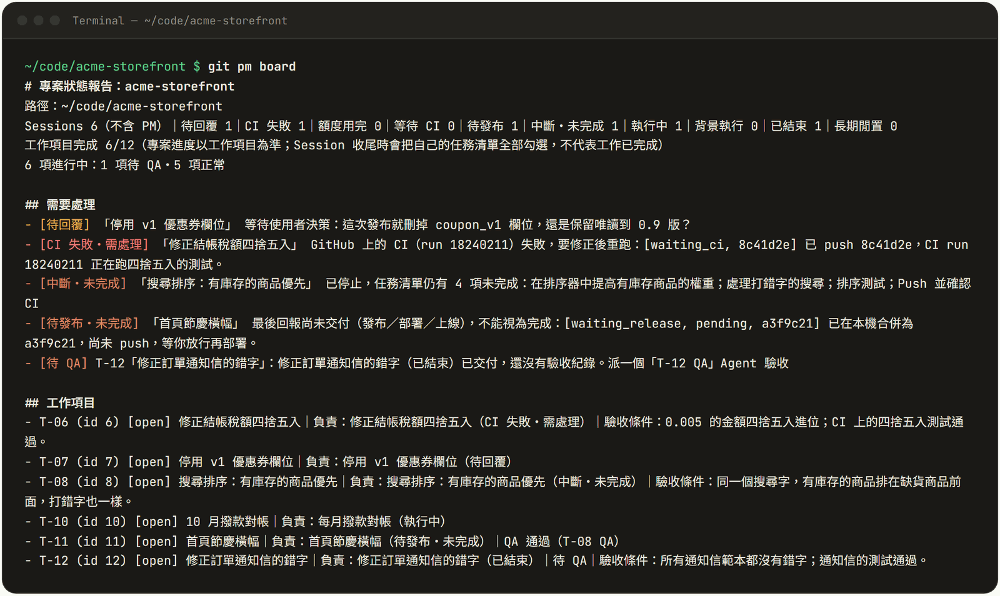

# Project PM：Claude Code 的專案 PM

[English](README.md) | **繁體中文**

[](https://github.com/AudiChang-hub/claude-project-pm/actions/workflows/ci.yml)
[](LICENSE)

**同時開很多個 Claude Code Session 和 Agent，你只跟一個 PM 說話，一件工作也不漏。**

<picture>
  <source media="(prefers-color-scheme: dark)" srcset="docs/images/hero-dark-zh-TW.png">
  
</picture>

<p align="center">
  
</p>

## 解決什麼問題

同一個專案開了好幾個 Session，工作就會漏掉：問題等你等了一小時、Session 還剩幾步就停了、說好「CI 跑完再部署」卻沒人回頭確認，而且每個 Session 收尾時都會把自己的清單全勾掉，不管事情做完了沒。

Project PM 讓專案裡的一個 Session 擔任 PM。它即時掌握每個 Session 和 Agent 的狀態，記下你交辦的每件事；只要還有事在等你、沒做完、等 CI，或還沒 push、還沒發布，它就不會說「都完成了」。

## v1.2 新功能

- **一鍵設定。** 裝好 mod，在看板上按**設定**就好，不用下載檔案、不用打指令：mod 會從這個專案的 GitHub 發布頁取得核心、用發布頁的 SHA-256 清單核對，改任何東西之前先列出會改哪些地方。
- **一鍵移除。** 按**移除設定**，每個檔案都還原成原本的樣子。
- **設定時認得你的 Claude Code。** 認得桌面版內建的 Claude Code，也看得到你實際在用的 mod 版本。

v1.1（兩邊同一份交辦清單、更好懂的看板、從面板打開網頁看板）和更早的版本：[CHANGELOG](CHANGELOG.md)

## 安裝

**Claude Code 桌面版**（Code 分頁）：

```
/plugin install project-pm --marketplace AudiChang-hub/claude-project-pm
```

或點提示框旁的 **+** → **Plugins** → **Add marketplace** → 輸入 `AudiChang-hub/claude-project-pm` → **Add plugin**。

接著在專案裡新開一個 Session，讓它當 PM（按提示框上方的按鈕，或輸入 `/pm`），在看板最上面按**設定**，就完成了。改任何東西之前，看板會先列出會改哪些地方；按**移除設定**可以全部還原。沒有網路或下載失敗時，看板會說明原因，並提供**重試**按鈕。在還沒設定的專案打開看板時，會自動開始下載核心（約 100 MB）；按**設定**之前不會改任何東西。

保持更新：`claude` → `/plugin` → **Marketplaces** → `claude-project-pm` → **Enable auto-update**。

**Claude Code CLI**（沒有桌面版時）：從 [Releases](https://github.com/AudiChang-hub/claude-project-pm/releases) 下載你電腦用的檔，在專案資料夾裡加上 `init` 執行。沒加 `--yes` 之前不會改任何東西。也可以把檔案放進專案資料夾後按兩下：它會列出會改哪些地方，按 Enter 才設定；設定好之後再按兩下會打開看板。設定時程式會複製到 `~/.project-pm/bin`，之後就可以把專案資料夾裡的這個檔案刪掉。npm 版（`npx`）之後的版本才提供。

逐步說明，以及 Windows 或 macOS 跳出警告時怎麼辦（放行步驟還沒實際驗證）：[core/README.zh-TW.md](core/README.zh-TW.md)。

## 支援平台

✅ 可用 · ◐ 部分 · — 不提供

| 功能 | Claude Code 桌面版 | Claude Code CLI¹ |
| --- | :-: | :-: |
| 一鍵設定 | ✅ | — |
| 看板 | ✅ | ✅ |
| 網頁看板² | ✅ | ✅ |
| 交辦清單，兩邊共用³ | ✅ | ✅ |
| QA 關卡，兩邊共用³ | ✅ | ✅ |
| 交付判斷（git、CI） | ✅ | ◐ |
| 即時追蹤 Session | ✅ | ◐ |
| Agent 派工 | ✅ | ◐ |
| 開發準則 | ✅ | ✅ |
| CI 範本⁴ | ✅ | ✅ |

¹ 在 Claude Code 2.1.326 實測。看板是網頁看板和 `git pm board`。部分支援的地方：CI 狀態（git 有檢查）、只看得到裝了 hook 的 Session、不會自動設定 Agent。
² 要先有核心：在桌面版看板按**設定**，或上面 CLI 的步驟。桌面版按面板上的**在瀏覽器開啟**。
³ 設定好之後；設定之前，桌面版用自己的一份。
⁴ GitHub Actions，在你的 repo 每次 push 和 pull request 時執行。

這張表是 v1.2 的狀態，每次推版都會更新。

## PM 幫你守住什麼

- **等你回覆的排最前面**，附上原本的問題。
- **CI 要 GitHub 說通過才算**：PM 用 `gh` 查實際結果。
- **沒上線就不算完成**：有沒有 commit、push 由 git 判斷，有沒有發布看 Session 的回報。
- **沒做完、沒驗收的工作不能結案**，除非你明確同意。

<details>
<summary><b>看看板長什麼樣</b>（示範資料）</summary>
<br>
<p align="center">
  <picture>
    <source media="(prefers-color-scheme: dark)" srcset="docs/images/board-dark-zh-TW.png">
    
  </picture>
</p>
</details>

每個狀態的意思、交付怎麼判斷、開發準則，以及 Mod 在你電腦上留下哪些資料：[運作方式](docs/how-it-works.zh-TW.md)。

## 指令（桌面版）

| 指令 | 作用 |
| --- | --- |
| `/pm` | 讓目前的 Session 擔任 PM，並打開看板 |
| `/pm off` | 卸任 PM；交辦清單留給下一任 |
| `/board` | 在任何 Session 打開或收合看板 |
| `/pm lang en`・`zh-TW`・`auto` | 看板和 PM 的語言；`auto` 跟隨系統 |
| `/pm guidelines <檔案>`・`off` | 讓 PM 和各 Session 遵守你的開發準則 |

**兩種看板。** Claude Code 桌面版：看板在右側面板（最上面那張）。網頁看板在瀏覽器裡顯示同一份工作，給 CLI 或第二個螢幕用：

- **先設定：** 在桌面版看板最上面按**設定**（沒有桌面版時，用上面 Claude Code CLI 那一步）。
- **打開：** 桌面版按面板最下面的 **在瀏覽器開啟**；終端機在專案資料夾執行 `git pm open`；或直接問 PM「看板網址」。
- **只輸入 `127.0.0.1:47130` 會看到錯誤頁。** 看板只能用 Project PM 給的連結打開，連結裡有一把私密金鑰，電腦上其他程式才讀不到。

<picture>
  <source media="(prefers-color-scheme: dark)" srcset="docs/images/web-board-dark-zh-TW.png">
  
</picture>

<details>
<summary><b>在 CLI 裡的樣子</b>（示範資料）</summary>
<br>
在終端機裡，PM 讀取看板，告訴你哪些在等你：

<code>git pm board</code> 印出同一份看板，Session 以名稱顯示：

</details>

## 需求

- Claude Code 桌面版（Mod，已在 2.1.317 測試），或 Claude Code 的 CLI（核心，已在 2.1.326 測試）。
- 一鍵設定用系統內建的 `curl` 下載（Windows 10 和 11、macOS、大部分的 Linux 都有）。
- 用系統的 `curl` 是因為 Mod 的 API 不能寫二進位檔。它會先透過 Claude Code 向 GitHub 取 `SHA256SUMS`，所以公司的網路規定一樣有效；SHA256 核對相符後才會執行程式。
- 選用：已登入的 [GitHub CLI](https://cli.github.com/)，讓 PM 能查 CI。
- 會改檔案的 Agent 需要 git repo。在桌面版，Agent 跑在 PM 的程序裡，重開 Claude Code 會中斷它們，看板會標成「已中斷」。

## 授權

[MIT](LICENSE)。測試：`claude plugin test .`，以及在 `core/` 裡執行 `npm test`。
