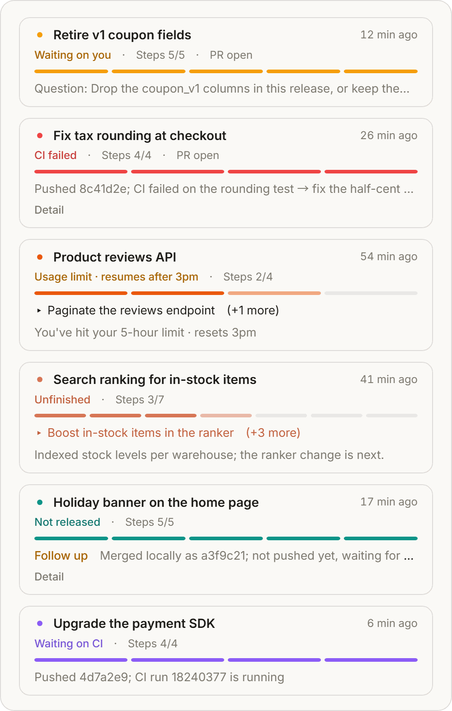
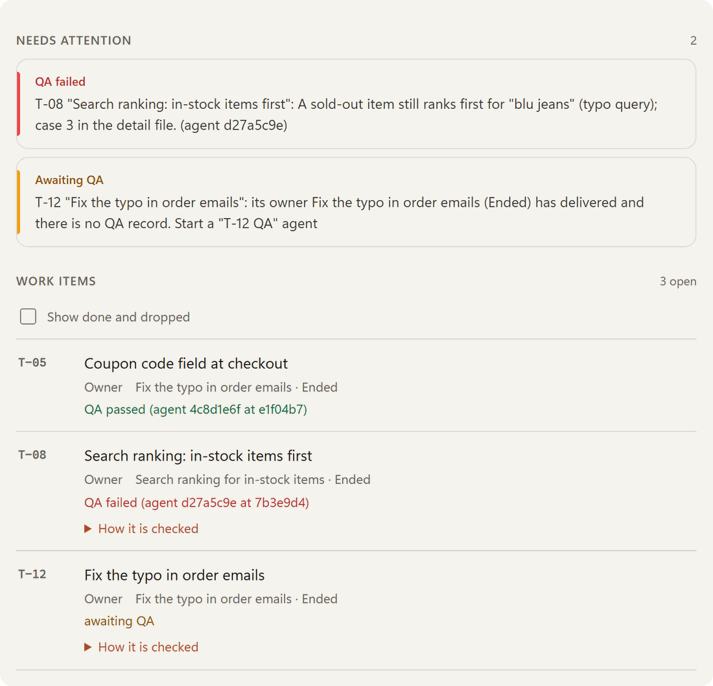
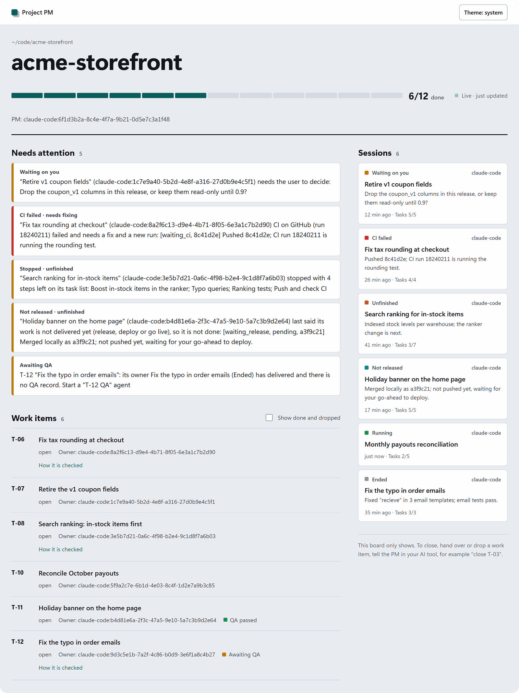
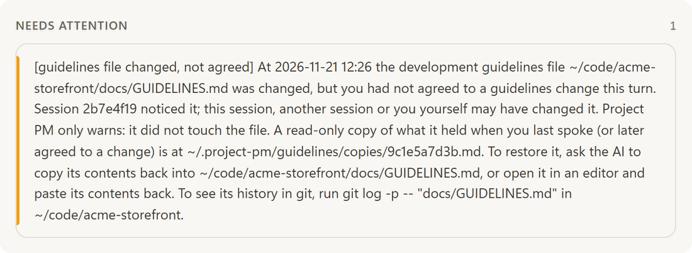

# How Project PM works

[README](../README.md) · **English** | [繁體中文](how-it-works.zh-TW.md)

The details behind the README: what each status means, how the PM decides whether work is delivered, the commands and tools, development guidelines, language, and what the mod keeps on your machine. Changes by version are in the [CHANGELOG](../CHANGELOG.md).

## Features


**One board per project.** A pane that lists the project's sessions, most urgent first, each with a status mark, a step-by-step progress bar, the step it is on, and its latest recap or question.

| Status | Shown when |
| --- | --- |
| Waiting on you (待回覆) | The session ended its turn with a question for you. |
| CI failed (CI 失敗) | Its last words left CI running, and GitHub reports that run failed. |
| Usage limit · resumes after *time* (額度用完・*time* 後可續) | A usage limit ended its last turn midway, read from the turn's error in the transcript, never from the model's words. The PM picks it up once the limit resets. |
| Unfinished (未完成) | It stopped with steps of its task list still open, and nothing it waits on is still running. |
| Not released (待發布) | Work is left to deliver, judged facts first (see *How delivery is judged* below): a commit or push git shows is left, a release the session declared pending, or, with neither to go on, words that say the work is still to come. A fully ticked task list does not override it (`wrap_up` ticks every step). |
| Waiting on CI (等待 CI) | Its last words say CI has not finished, and GitHub has not said it passed. |
| Running (執行中) | The session is working right now. |
| In the background (背景執行) | A command or an agent it started in the background (`run_in_background`, or moved there) has not reported back yet, for up to 6 hours; or, for a turn that ended with neither a `report` nor a `wrap_up` recap, it said work goes on in the background (for up to 45 minutes). Open steps on its task list do not make it *Unfinished* meanwhile. |
| Ended (已結束) / Idle (長期閒置) | Nothing left; idle for more than 3 days. Hidden behind a toggle. |

<p align="center">
  
</p>

At the top: a completion ring and three counters (running, waiting on you, not finished: unfinished, waiting on CI, CI failed or not released). Switch between **this project** and **all projects**.

**A ledger of what you asked for.** Every request you give the PM is recorded as T-01, T-02, … with the session that owns it. Project progress is counted from the ledger, not from the sessions' own checklists. An owner working from another project's folder (a session fixing a shared library, say) is still shown with its title and status; the item is flagged only when its owner is archived or gone.

**CI is not done until GitHub says so.** When a session's latest words say CI is still running, or that it will deploy once checks pass, the session is held at *Waiting on CI*, however long ago it stopped. Quoted words (a status named 「等待 CI」) and sentences about a rule or an example do not count. The PM then runs `gh` in that session's folder: the runs and commits the words name, nearest their own CI words first, a commit only when it is in that repository (a hash quoted from another project or an example is skipped), and when none of them answers, the folder's `HEAD` (only if it was committed before the words). A pass clears the status, a failure turns it into *CI failed*. Answers are cached: a pass for good, a failure for 5 minutes, a running or unknown result for 1 minute. Without `gh`, or outside GitHub, the words decide.

**The ledger will not close unfinished work.** Marking an item done is refused while its owner is running, waiting on you, unfinished, waiting on CI, failed CI, not released or still working in the background, unless you confirm it explicitly and the PM records why in a note.

**QA before a work item closes.** A work item can carry acceptance criteria and a QA verdict. The ledger will not mark an item done without a passed QA, or a skip with its reason, and whoever checks it may not be its owner. Before a code change is pushed, the PM starts an independent QA agent given only the diff and the criteria. *Needs attention* lists items awaiting QA (their owner has delivered and there is no verdict) and items that failed QA, and each work item shows its QA. In the CLI, a git pre-push hook also holds commits no QA passed.

<p align="center">
  
</p>

**Recaps that admit work is left.** A recap that says something is "not yet deployed", "not committed", "still needs…" (in English or Chinese) is flagged for follow-up. A Chinese double negative such as 沒有任何未提交的修改 ("there are no uncommitted changes") is not.

**Only the latest turn counts.** A recap belongs to the turn that wrote it; a later turn that ends without its own recap clears it. If a session's record has missed later turns, its transcript's last message is used instead.

**A PM that behaves like one.** The PM reads the board before every report, hands implementation to other sessions instead of editing code itself, relays sub-sessions' questions to you word for word, asks before archiving anything, and will not say "all done" while anything needs attention. It gets a notification when a session starts waiting on you, fails CI, or stops with steps left.

**The PM hears at once.** When a session reports or ends a turn, its mod sends the PM a one-line update (`$.session.send`), and the PM's mod takes it in (`session.receive`) before it reaches the PM's conversation: the board is redrawn within a moment, without starting a turn or spending tokens. Only a PM whose mod can take the update in is sent one; the 30-second poll stays as the fallback.

**Housekeeping.** Archive a finished session from its card (hover to reveal, then confirm; the confirm warns about open steps, an open PR or a pin). In a project with no PM yet, a band above the prompt offers to start a PM session or make the current one the PM.


## Sessions or agents


The PM hands each piece of work to a session or to an agent; you still talk only to the PM. Work it will follow up on, that commits, pushes, waits on CI or releases, or that takes long goes to a session. Work that ends when it is done, read-only questions and changes of a few minutes go to an agent (the Agent tool). The PM puts quota first: a session already open takes the work only if it was active within the last hour and has not run many turns (measured at about 18,000 input-equivalent tokens, the cheapest). Waking a session idle for over an hour, or a large one, writes its whole context into the cache again (a 650,000-token context measured at about 840,000), so a small thing then goes to a new session (about 70,000) or an agent (about 60,000 for a read-only Explore agent, 120,000 to 150,000 for one that writes files). To change course mid-way, tell the PM; it passes your words on to the agent.

For the PM's own Agent calls the mod:

- runs the agent in the background, so the PM goes on and you can keep talking to it;
- puts an agent that may write in a git worktree of its own (`isolation: "worktree"`), where it commits for the PM to verify and merge; `Explore`, `Plan` and `claude-code-guide` only read and stay in the folder; outside a git repository an agent that may write is refused;
- adds a brief to its prompt: report in one line (`[status, commit] summary`), write the full account to a detail file, do not push or release, and your development guidelines;
- cuts the agent's reply in the notification the PM reads to that first line and the detail file's path, and keeps the rest on disk;
- lets an agent read the ledger but not change it.

Each agent is tracked in the PM's record: running, done, *to verify* (it committed on its worktree branch and the PM has not merged it yet), *needs decision*, failed, *interrupted* (the PM's process ended while it ran), or *dropped* (its work items were dropped after it ended, or no branch holds its commit any more). A work item's owner can be an agent (`agent:<agentId>`); the ledger closes it only once the agent is done, a commit counting once it is merged into the project's branch. The board has an *Agents* section, agents are drawn with a diamond where sessions have a dot, and an agent that failed, needs a decision, waits to be verified or was interrupted shows under *Needs attention*. The design and its tests: [docs/design/agents.md](design/agents.md).

## How delivery is judged


Facts first, words last:

1. **Git, for commit and push.** For each session of its own project the PM reads the session's folder, read-only and without fetching. A folder with no uncommitted changes has nothing left to commit. The commit the report names as its own (commit 是 3fa1c2e, 提交為 3fa1c2e, amended into 3fa1c2e), or a clean folder's HEAD, on a remote branch has nothing left to push; a named commit on no remote branch has its push left, whatever the words say. A commit cherry-picked or rebased onto a remote branch counts as pushed, though its SHA differs: the PM looks for it on the remote's default branch and the four branches updated last, cheapest check first: the same patch (`git cherry`), then a commit of the same title that adds at least 95% of its lines (a conflict resolved on the way), then the same file contents (a squash). Git only settles or confirms what it can check: a folder shared with other sessions may hold their changes, so a dirty folder alone adds nothing.
2. **The session's own report, for where the work stands.** In a project with a PM, the other sessions get a `report` tool (`mcp__project-pm__report`) and are asked to call it whenever they finish, pause or get stuck: a `status` (`done`, `in_progress`, `blocked`, `waiting_user`, `waiting_ci`, `waiting_release`), a one-sentence `summary`, and, when they apply, the `commit`, the `ci` run still going, the `delivery` (`not_needed`, `released`, `pending`) and a `detail`: the full account, which the mod saves to `~/.claude/project-pm/reports/<session id>/<time>.md`. The PM reads only the report's one line and the file's path; the board's card has a *Detail* button that opens the file for you. The sessions are also asked to keep their messages to the PM (SendMessage, the wrap_up recap, the final answer) to the same short form, about 300 characters: status, commit, a one-line summary and the detail file's path. The board goes by those fields, never by the summary's wording; git (step 1) and GitHub still check the commit and the CI run it names. A report holds for the turn that made it. `released` (or `交付：已部署`) means nothing is left, commit and push included, however the commit reached the release; the board quotes the report itself (`[done, released, 3fa1c2e] …`) beside its verdict. A session that cannot call the tool ends its recap with one line instead: `交付：不需要部署`, `交付：已部署（…）` or `交付：待部署（等…）` (`Delivery: not needed`, `deployed (…)`, `pending (…)`). Sessions of projects without a PM are told nothing.
3. **Words, only where neither answers.** A report leaves work only when it says the work is still to come: not yet (還沒, 尚未, 未, not yet), what comes next (之後再部署, I'll push after review), a wait (等 PM 放行後部署), or work still sitting here (只在本機，沒有 push). A plain "not done" (沒有打標籤也沒有部署, didn't push) does not count: as often as not it means this time needed none. Rules, examples, quoted words, someone else's work and descriptions of the board are set aside first.

Closing a work item settles it: once every item a session owns is done, a verdict read from its report (not released, steps left) no longer lists it under *Needs attention*, until the session reports again. What is happening (running, waiting on you, CI, background work) still shows.

What this lets through: a plain "沒有 commit" of changes that really are uncommitted, or "沒有部署" of a release that really is due, from a session that neither declared it nor named a commit of its own. A declaration, a commit named in the report, or the open steps of its task list bring those back.

## Usage


| Command | What it does |
| --- | --- |
| `/pm` | Makes this session the project's PM and opens the board. |
| `/pm off` | Steps down as PM. The ledger stays with the project for the next PM. |
| `/board` | Opens or closes the board in any session. |
| `/pm lang en` · `/pm lang zh-TW` · `/pm lang auto` | Switches the language of the board, the PM and its tools at once, and saves it as the `language` option. `auto` follows the system. |
| `/pm guidelines <file>` · `/pm guidelines off` | Sets or clears your development guidelines (see below). `/pm guidelines` alone shows the file in use and whether it reads. |

The PM has two tools of its own, which you do not call directly:

- `mcp__project-pm__board`: the project status report (what needs attention, the ledger, every session). Pass `scope: "all"` for every project, `include_done: true` to list finished sessions and items too.
- `mcp__project-pm__ledger`: `add`, `update` (owner, status `open` / `done` / `dropped`, note) and `list` the work items. `add` and `update` answer with the one item they changed; `list` shows the open items, `include_done: true` every item, and an `id` one item with its text and note in full. In a list each text and note is cut to one short line, so a ledger of hundreds of items costs the PM a few hundred characters a call.

A project is the folder a session works in; a git worktree under `.claude/worktrees/` or `.worktrees/` counts as its repository.

### Web board (CLI)

Two boards, one for each way in. In the Claude Code desktop app the board is the pane beside your conversation (`/board`; its cards are shown under *Features* above). In Claude Code's CLI the board is this web page, which looks different. `project-pm open` starts its server when needed and opens it in your browser; `project-pm serve` runs the server in the terminal. It is read only, listens on your own computer only (127.0.0.1), needs the key in the link it prints, and stops after 30 minutes unused. It shows progress, what needs attention, the work items with their QA, and each session with the tool it runs in. `project-pm board` prints the same board in the terminal.

<picture>
  <source media="(prefers-color-scheme: dark)" srcset="images/web-board-dark.png">
  
</picture>

### Development guidelines

Point the `guidelines` option at a Markdown file of your own rules (how to commit, when to ask before a schema change, what counts as done), and the PM and every other session of a project with a PM get it in their system prompt each turn. The PM is also told to carry out what the rules leave to a coordinator (version numbers, the order of pushes and deployments, the definition of done) and to point out a session that breaks one.

- **A request against the rules is asked about first.** The session says which rule the request breaks and asks whether to make an exception this time, and goes ahead only on a clear yes.
- **An exception is one-off.** Once that request is done the rules apply again, and a similar request later is asked about again. The PM notes each approved exception on its work item.
- **The rules change only when you ask.** An edit to the guidelines file is refused unless your latest message in that session asks about the guidelines (it mentions 準則, 守則 or "guideline"). The refusal tells the session to ask you first.
- **A change you did not agree to is warned about** (CLI). If the guidelines file or setting changes in a turn where you did not agree to a guidelines change, the board lists it under *Needs attention* for a week: when, which session noticed it, and how to undo it yourself (a read-only copy of what the file held when you last spoke, and `git log -p` for a project's file). Project PM never puts the file back.

<p align="center">
  
</p>

- The path may be absolute, `~/…`, or relative to each project's folder (`docs/GUIDELINES.md`), so every project can keep its own.
- The file is read on every turn: an edit reaches each session's next turn with no reload. Its text stays on your machine; a file over 24,000 characters is cut, with a note to read the rest.
- Set it with `/pm guidelines <file>` or the `project-pm.guidelines` row in `/config`. Sessions of projects without a PM are not given it.

## Language


The board, the band above the prompt, the commands' replies, the notifications, the PM's instructions and its tools speak **English** or **Traditional Chinese**.

- **By default it follows the system language** (on Windows, the display language): any Chinese locale shows Traditional Chinese, everything else English. Simplified Chinese locales show Traditional Chinese too; run `/pm lang en` if you would rather read English.
- **To choose one**, set the plugin's `language` option to `auto`, `en` or `zh-TW` (the `project-pm.language` row in `/config`, stored under `pluginConfigs` in `settings.json`), or type `/pm lang en`, `/pm lang zh-TW` or `/pm lang auto` in any session. The command takes effect at once and saves the option.
- Reading what sessions report works in both languages whichever one the board speaks, so sessions can work in English or Chinese.

Every string lives in [`hooks/messages.ts`](../hooks/messages.ts), one table per language.

## Data and privacy


- Each session writes only its own record: `~/.claude/project-pm/sessions/<session id>.json` (its task list, last recap, open question, latest prompt and last answer, clipped, and whether you left its board open).
- Each project has one file for its PM and ledger: `~/.claude/project-pm/projects/<project>-<hash>.json`.
- A board keeps its last round (the sessions listed, their last messages, what git and GitHub said) in `~/.claude/project-pm/rounds/<session id>.json`, and `~/.claude/project-pm/transcripts.json` says which session each transcript belongs to, so a resumed session draws its board at once.
- The mod itself sends nothing anywhere. Listing, reading and archiving sessions go through the desktop app's built-in tools. To check CI and delivery it runs `git` and `gh` in the session's folder, read-only (`git status` without refreshing the index, `branch -r --contains`, `rev-parse`; no fetch), so `gh` contacts GitHub with your own login, as it would if you ran it yourself.
- In a project with a PM, the other sessions get one short instruction each turn and the `report` tool: report where the work stands, or end the recap with a delivery line (see *How delivery is judged*). They send the PM a one-line update naming themselves when they report or end a turn. Sessions of other projects get nothing.
- Sessions opened before the install keep no record; the board shows their last message, read from the transcript.
- When the engine drops the PM's `board` and `ledger` tools (after `/reload-plugins`, or when the mod's folder changed and a command of it such as `/board` reloads it), they come back on the PM's next turn (your next message or a notification) or within 30 seconds while the PM is idle; no need to restart the session.
- The board stays as you leave it: `/board` or `/pm` opens it, `/board` or the pane's close closes it. When the desktop app stops an idle session to free memory and resumes it later, or the engine drops the pane, a board you left open comes back as the session resumes, drawn from its last round.
- The desktop app stops every session idle for a minute or more whenever free memory falls under 5%, counting Windows' commit limit (memory plus page file) as well as free memory. A board that keeps disappearing usually means the commit limit runs short: a larger page file, or fewer heavy processes, keeps sessions running. The mod itself adds about 40 MB of commit per session; each PM asks git and GitHub only about its own project (every project while the board shows them all), asks again about CI GitHub knows nothing of every ten minutes, and redraws the board only when something changed or while it is on screen.

## Development


```bash
claude plugin validate .
claude plugin test .
```

The tests (`tests/pm.test.ts`) run against Claude Code's plugin test host with an in-memory desktop app, disk and `gh`; they need no login or API key. CI runs the same two commands on every push and pull request.

`docs/demo/board.html` draws the README images from made-up data; see [docs/demo/README.md](demo/README.md).

Changes are listed in [CHANGELOG.md](../CHANGELOG.md).
